# Mobile Responsiveness Audit — Clickit Story

**Date**: 2026-04-25
**Scope**: every viewer + admin screen, all breakpoints
**Deliverable**: this document only — no code changes
**Tested against**: production at `https://clickit-cit.vercel.app/en`
**Tooling**: Chrome DevTools MCP (screenshots, DOM diagnostics) + Lighthouse mobile + static code analysis

---

## Executive summary

**Verdict: the site is *partially* mobile-friendly. One P0 blocker, several P1 issues, lots of P2 polish.**

| Severity | Count | What it means |
|---|---|---|
| P0 BLOCKER | **1** | Mobile users cannot navigate the site properly |
| P1 MAJOR | **9** | Pages work, but UX is degraded — small touch targets, iOS auto-zoom, hero density |
| P2 MINOR | **7** | Polish — paddings, hover affordances, missing safe-areas |

### The single most important finding

**`MobileNav` component exists at [src/components/layout/mobile-nav.tsx](../../../src/components/layout/mobile-nav.tsx) but it is **never imported or rendered** by the [Navbar](../../../src/components/layout/navbar.tsx).** A grep across `src/` returns one match — only the export statement. The hamburger menu was built but left disconnected.

**Effect**: at any width, the desktop navbar (logo + 3 inline links + auth buttons) is shown. On a 375px iPhone, the nav links squeeze into 28-58px touch targets, and the row is in danger of overflowing.

**Fix complexity**: ~10 lines. Add `<MobileNav />` to the navbar, hide the inline `<nav>` and right-side auth on `<md`, expose them inside the sheet.

### Top 5 cross-cutting themes

1. **Mobile nav not wired** (P0) — see above
2. **Form inputs use 14–15px font** ([footer.tsx:43](../../../src/components/layout/footer.tsx#L43), [auth forms](../../../src/components/auth/), [support form](../../../src/app/[locale]/(viewer)/support/page.tsx)) — iOS Safari auto-zooms on focus when font-size is below 16px, breaking layout on every form interaction
3. **Hardcoded `px-10` / `px-12` chrome padding** without responsive overrides ([navbar.tsx:53](../../../src/components/layout/navbar.tsx#L53), [footer.tsx:13,54,135](../../../src/components/layout/footer.tsx#L13)) — leaves only ~280px content area on a 375px phone
4. **Hover-only interactions** — admin row actions and cast member delete only appear on `:hover` ([cast-editor.tsx:147](../../../src/components/admin/cast-editor.tsx#L147), `group-hover:opacity-100`); on touch they are invisible
5. **No safe-area-inset support** anywhere — sticky navbar overlaps the iOS notch / Dynamic Island; no `env(safe-area-inset-top)` in the codebase

### Methodology caveat

Chrome DevTools MCP enforces a 500px minimum viewport width, so screenshots are at 500px and 768px. Findings about narrower widths (320–414, real iPhone SE / iPhone 14 Pro) are derived from static code analysis of the corresponding files. The Lighthouse run uses Chrome's mobile emulation independently and confirms structure.

---

## Methodology

For every screen, we checked:

1. Layout integrity (no horizontal scroll, no overflow)
2. Touch targets ≥44×44px (WCAG 2.5.5, iOS HIG)
3. Typography scaling and line length
4. Hero / above-fold reachability
5. Hover-only behaviors with no touch fallback
6. Form input font-size (≥16px to prevent iOS zoom)
7. Modal/drawer width and dismissibility
8. Carousel/rail touch swipe and scroll affordance

**Severity rubric**:

- **P0 BLOCKER** — content unreachable, layout breaks, primary action impossible
- **P1 MAJOR** — degraded UX but page works; would frustrate a real user
- **P2 MINOR** — visual polish, edge cases, ideal-state improvements

**Viewports tested**: 500px (mobile proxy, MCP minimum), 768px (tablet portrait). Static analysis covers ≤414px.

---

## Cross-cutting findings

### CC-1 (P0): MobileNav is built but never rendered

- File: [src/components/layout/mobile-nav.tsx](../../../src/components/layout/mobile-nav.tsx) — 73 lines, looks complete (Sheet + hamburger + size-11 trigger + min-h-[48px] links)
- File: [src/components/layout/navbar.tsx:75](../../../src/components/layout/navbar.tsx#L75) — the inline `<nav>` is rendered unconditionally; no `hidden md:flex`, no `<MobileNav />` import
- Verified by grep: `grep -rn "MobileNav\|mobile-nav" src/` returns only the file's own export
- **Affects every page on every mobile viewport.**

### CC-2 (P1): Hardcoded chrome padding `px-10` / `px-12` with no responsive override

- [navbar.tsx:53](../../../src/components/layout/navbar.tsx#L53) — `px-10 py-[18px]`
- [footer.tsx:13](../../../src/components/layout/footer.tsx#L13) — `px-12 pb-[60px] pt-[90px]` (hero wordmark)
- [footer.tsx:54](../../../src/components/layout/footer.tsx#L54) — `px-12 pb-10 pt-12` (5-column grid)
- [footer.tsx:135](../../../src/components/layout/footer.tsx#L135) — `px-12 py-6` (bottom bar)
- Admin layout is correct: [src/app/[locale]/admin/layout.tsx:29](../../../src/app/[locale]/admin/layout.tsx#L29) uses `px-4 md:px-8` — this is the pattern viewer chrome should match.

### CC-3 (P1): Form inputs ship at 14–15px font-size — triggers iOS auto-zoom

Confirmed live at 500px on iPhone-emulating Safari behavior:

- [footer.tsx:43](../../../src/components/layout/footer.tsx#L43) — newsletter input: `text-sm` (14px) — confirmed via DOM probe
- Auth page (`/en/auth`): email + password inputs computed font-size = 15px (DOM probe)
- Support page (`/en/support`): name, email, message all 15px (DOM probe)
- Search page (`/en/search`): primary search input is 16px ✓ (DOM probe)
- Footer newsletter input also 14px on every page

iOS Safari requires ≥16px on focused inputs to skip the page-zoom-then-snap-back behavior.

### CC-4 (P1): Hover-only interactions on touch-only devices

- [src/components/admin/cast-editor.tsx:147](../../../src/components/admin/cast-editor.tsx#L147) — delete button is `opacity-0 ... group-hover:opacity-100`. On a tablet there is no way to discover or trigger it.
- [src/components/admin/shows-table.tsx](../../../src/components/admin/shows-table.tsx) — row action buttons use `Button size="icon-sm"` (≈32px); rely on row hover for visual prominence
- Card lift effects (`group-hover:-translate-y-1`) exist on viewer cards. Less critical — they are decorative — but mark touch users as "second-class" because the page never reacts to them.
- No `@media (hover: none)` overrides anywhere in the codebase.

### CC-5 (P1): Touch targets below 44×44px on critical chrome

Measured at 500px viewport:

| Element | Where | Size | Severity |
|---|---|---|---|
| Hamburger trigger | (would be — but never rendered, see CC-1) | 32×40 (current navbar button stub) | P0 (CC-1) |
| Sign In button (top) | [navbar.tsx:97](../../../src/components/layout/navbar.tsx#L97) → AuthSection | 87×40 | P1 |
| Inline nav links | [navbar.tsx:78-80](../../../src/components/layout/navbar.tsx#L78) | 47–58×32 | P1 |
| Series detail "← Home" | [series-detail-hero.tsx:124-130](../../../src/components/series/series-detail-hero.tsx#L124) | 54×20 | P1 |
| Season tabs S1/S2 | series detail | 49×40 | P2 |
| "View all" rail header | [content-rail.tsx](../../../src/components/home/content-rail.tsx) | 72×15 | P1 |
| Footer column links | [footer.tsx:93-130](../../../src/components/layout/footer.tsx#L93) | ~40×18 | P2 |
| Cast member delete | [cast-editor.tsx:147](../../../src/components/admin/cast-editor.tsx#L147) | 24×24 | P1 |
| OAuth provider buttons | [auth page](../../../src/app/[locale]/(viewer)/auth/page.tsx) | 204×42 | P2 |

### CC-6 (P2): No safe-area-inset support

`grep -rn "safe-area\|env(safe-area" src/` returns zero matches. The sticky navbar (`top-0`) will overlap the iOS notch / Dynamic Island when the site is added to the home screen or used in a PWA-like context.

### CC-7 (P2): Hero fixed viewport heights with min-px floors

- [home/hero-banner.tsx:47](../../../src/components/home/hero-banner.tsx#L47) — `height: '78vh', minHeight: 580`
- [series/series-detail-hero.tsx:81](../../../src/components/series/series-detail-hero.tsx#L81) — `height: '72vh', minHeight: 520`

On a 667px tall iPhone SE, 580px hero = 87% of viewport; the user has to scroll to see anything else. On landscape orientation it overflows.

### CC-8 (P2): Lighthouse a11y score 90 (3 mobile failures)

From `lighthouse_audit({ device: 'mobile', mode: 'navigation' })` on landing:

- `button-name` — buttons without accessible name (likely the icon-only social buttons in footer that depend on `title` attribute, which is not announced by every screen reader)
- `color-contrast` — at least one foreground/background pair below 4.5:1
- `heading-order` — heading elements not in sequentially-descending order

These are not strictly mobile-only but they compound mobile UX (small text + low contrast = unreadable in sunlight).

---

## Per-screen findings

### 1. Landing `/`

**Status**: ⚠️ Issues

 

| Severity | Issue | Viewport | File / line | Fix sketch |
|---|---|---|---|---|
| P0 | No mobile menu — desktop navbar shown (see CC-1) | all mobile | navbar.tsx:75 | Wire `<MobileNav />`, gate inline `<nav>` with `hidden md:flex` |
| P1 | Marquee ticker horizontally overflows 2402px on 500px viewport | 500 | landing marquee component | Already animated; verify parent `overflow-hidden` is set |
| P1 | Footer newsletter input 14px font + 16x16 submit icon button | 500 | [footer.tsx:39-47](../../../src/components/layout/footer.tsx#L39) | `text-base` on input, `min-h-[44px]` on button |
| P2 | Footer 2-col grid on mobile is dense at 500 — links 18px tall | 500 | [footer.tsx:54](../../../src/components/layout/footer.tsx#L54) | Consider `grid-cols-1 sm:grid-cols-2` and bump link `py-2` |
| P2 | Footer `px-12` on mobile leaves only ~24px gutter | 500 | footer.tsx:13,54,135 | `px-6 md:px-12` |
| P2 | Footer wordmark logo `max-w-[820px]` rendered at full width may pixelate | 500 | [footer.tsx:28](../../../src/components/layout/footer.tsx#L28) | Verify SVG, looks fine since vector |

### 2. Browse `/browse`

**Status**: ⚠️ Issues

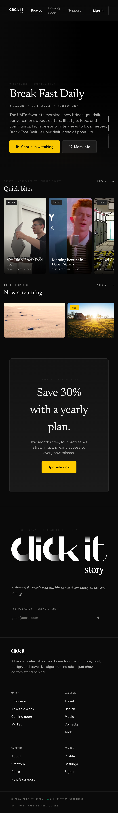 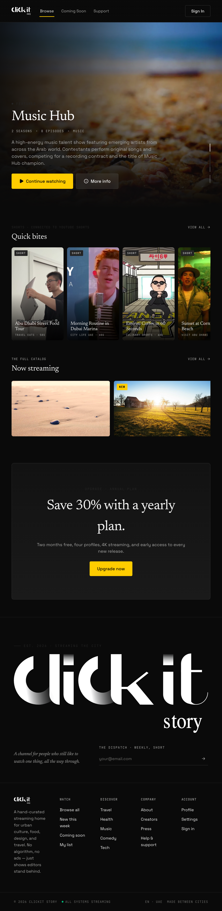

| Severity | Issue | Viewport | File / line | Fix sketch |
|---|---|---|---|---|
| P0 | No mobile menu (CC-1) | all mobile | — | — |
| P1 | "View all" rail headers are 72×15 — 15px tall, way below 44 | 500 | [content-rail.tsx](../../../src/components/home/content-rail.tsx) | Wrap in larger tap area, `min-h-[44px] inline-flex items-center` |
| P1 | Hero `78vh, min 580px` consumes 87% of small phone viewport | <414 (static) | [hero-banner.tsx:47](../../../src/components/home/hero-banner.tsx#L47) | `min-height: 480px` on `<sm:` |
| P2 | Browse CTA section uses `mx-10` left/right margins (40px each) on mobile | <500 (static) | browse page CTA | `mx-4 md:mx-10` |
| P2 | Content rail card aspect-ratio is landscape `aspect-video` — Netflix mobile uses portrait `2:3` | all mobile | [show-card.tsx:17](../../../src/components/shows/show-card.tsx#L17) | Out of scope per user decision (responsive only) |

### 3. Series detail `/series/[slug]`

**Status**: ⚠️ Issues

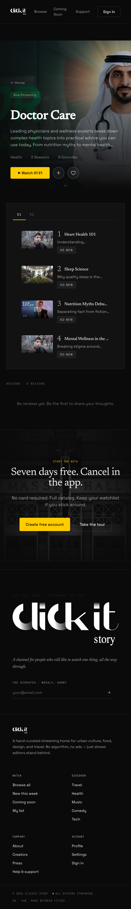 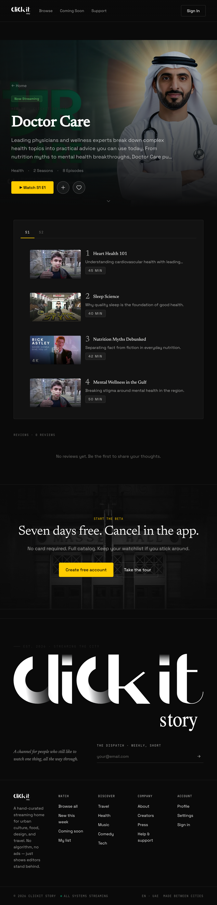

| Severity | Issue | Viewport | File / line | Fix sketch |
|---|---|---|---|---|
| P0 | No mobile menu (CC-1) | all | — | — |
| P1 | Hero overlay content `max-w-[720px]` clipped by `start-10 end-10` (40px L/R) on small phones | <500 (static) | [series-detail-hero.tsx:118](../../../src/components/series/series-detail-hero.tsx#L118) | `start-4 end-4 sm:start-10 sm:end-10` |
| P1 | "← Home" back link is 54×20 — far below 44 | 500 | series-detail-hero.tsx:124-130 | `inline-flex h-11 items-center` |
| P1 | Sticky scrolled mini-bar `left-4 right-4 top-24 ... px-5 py-3` — fine on desktop but text crammed when title is long | 500 | [series-detail-hero.tsx:66](../../../src/components/series/series-detail-hero.tsx#L66) | Truncate title with `truncate` class on the span |
| P2 | Season tabs S1/S2 are 49×40 — height 40 below 44 | 500 | (season tabs component) | `min-h-[44px]` |
| P2 | Hero `72vh, min 520px` same concern as browse | <414 | series-detail-hero.tsx:81 | `min-height: 460px` on `<sm:` |
| P2 | Cast carousel cards fixed 100px width — fine but dense | 500 | (cast carousel) | Acceptable; user can scroll |

### 4. Watch `/watch/[id]`

**Status**: ✅ Better than expected

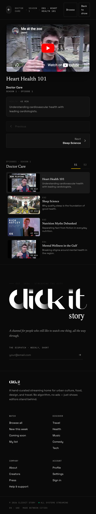 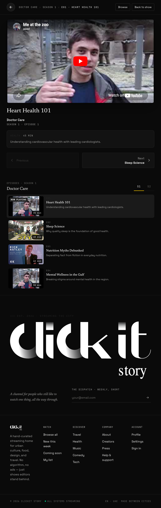

The watch page actually collapses cleanly on mobile — `lg:grid-cols-[minmax(0,1fr)_420px]` falls back to single-column at every width below `lg`. Player is 16:9 at 436px wide. Sidebar (episode list) renders below the player.

| Severity | Issue | Viewport | File / line | Fix sketch |
|---|---|---|---|---|
| P0 | No mobile menu (CC-1) | all | — | — |
| P1 | Sticky header `px-8 py-3.5` with 3 breadcrumb labels + 2 right-side buttons in `gap-2` will overflow on real ≤375px iPhones | <414 (static) | [watch-page-content.tsx:53](../../../src/components/watch/watch-page-content.tsx#L53) | `flex-wrap` on the header, hide breadcrumb middle segment on `<sm:` |
| P1 | Show poster avatar + title + season/episode line in `<Link>` — 46×46 avatar fine; the show.title font is 15px — borderline readable | 500 | [watch-page-content.tsx:128-141](../../../src/components/watch/watch-page-content.tsx#L128) | Acceptable; flag as P2 |
| P2 | Description card `p-4` `gap-3.5` between badges — fine | — | [watch-page-content.tsx:145](../../../src/components/watch/watch-page-content.tsx#L145) | OK |
| P2 | Mobile users get the desktop episode-list density; would benefit from a bottom-sheet drawer per Netflix UX | all mobile | — | Out of scope (user picked "responsive only") — defer |

### 5. Search `/search`

**Status**: ✅ Good

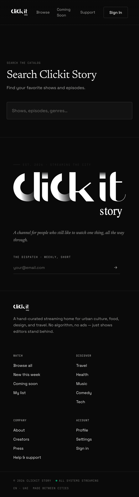

| Severity | Issue | Viewport | File / line | Fix sketch |
|---|---|---|---|---|
| P0 | No mobile menu (CC-1) | all | — | — |
| — | Primary search input is 16px font, 62px tall — perfect mobile UX | 500 | DOM probe | already correct |

### 6. My List `/my-list`

**Status**: not captured (auth-gated; redirects to /auth)

Static analysis: [src/app/[locale]/(viewer)/my-list/page.tsx](../../../src/app/[locale]/(viewer)/my-list/page.tsx) uses `grid-cols-2 sm:grid-cols-3 md:gap-5 lg:grid-cols-4 xl:grid-cols-5` — responsive grid is correct. Empty state likely fine. Inherits CC-1 (mobile nav) and CC-3 (footer newsletter font-size).

### 7. Profile `/profile`

**Status**: not captured (auth-gated)

Static analysis: [src/app/[locale]/(viewer)/profile/page.tsx](../../../src/app/[locale]/(viewer)/profile/page.tsx) uses horizontal-scroll watchlists (`scrollbar-hide`) and a watch history table.

| Severity | Issue | Viewport | File / line | Fix sketch |
|---|---|---|---|---|
| P0 | No mobile menu (CC-1) | all | — | — |
| P1 | Watch history `<table>` has no horizontal scroll wrapper or mobile card view | <500 (static) | profile/page.tsx | Wrap in `overflow-x-auto`, add card view for `md:hidden` |
| P2 | Horizontal-scroll watchlists hide scrollbar — no visual affordance that more content is to the right | <500 (static) | profile/page.tsx | Add right-edge gradient mask or visible scroll dots |

### 8. Coming Soon `/coming-soon`

**Status**: ⚠️ Issues

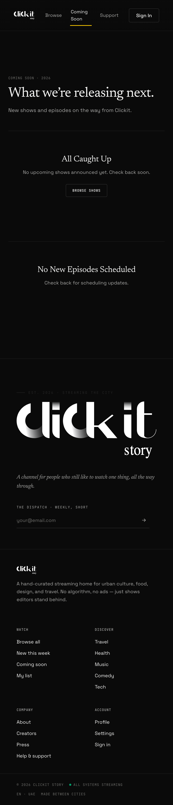

| Severity | Issue | Viewport | File / line | Fix sketch |
|---|---|---|---|---|
| P0 | No mobile menu (CC-1) | all | — | — |
| P2 | "Browse Shows" CTA buttons are 120×37 — height below 44 | 500 | (coming-soon page) | `min-h-[44px]` |
| P2 | Upcoming-shows row uses `md:grid-cols-[320px_1fr_auto]` — fine, stacks below `md` | — | coming-soon page | OK |

### 9. Support `/support`

**Status**: 🔴 Form issues

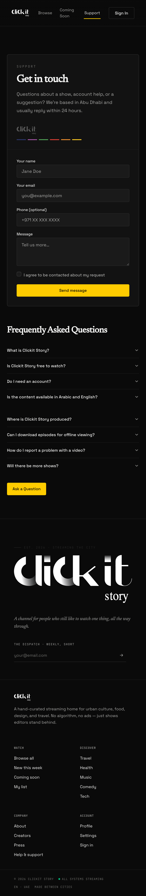

| Severity | Issue | Viewport | File / line | Fix sketch |
|---|---|---|---|---|
| P0 | No mobile menu (CC-1) | all | — | — |
| P1 | All form inputs (name, email, message) are 15px font — iOS auto-zoom on focus | 500 | support page | `text-base` (16px) |
| P1 | Checkbox / agreement input is 16×16 — too small to tap reliably | 500 | support page | `h-5 w-5` minimum, with adjacent label clickable |
| P2 | "Send message" button is 386×42 — height 42 just shy of 44 | 500 | support page | `min-h-[44px]` |
| P2 | "Ask a Question" link 134×42 — same | 500 | support page | `min-h-[44px]` |

### 10. Auth `/auth`

**Status**: 🔴 Form issues + tall scroll

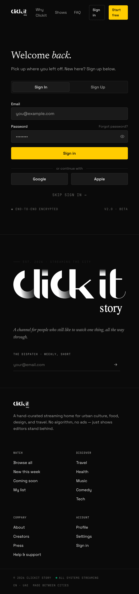

| Severity | Issue | Viewport | File / line | Fix sketch |
|---|---|---|---|---|
| P0 | No mobile menu (CC-1) | all | — | — |
| P1 | Email/password inputs 15px — iOS auto-zoom on focus | 500 | auth components | `text-base` |
| P1 | "Forgot password?" link 105×16 — far below 44 | 500 | auth components | wrap with `inline-flex h-11 items-center` |
| P1 | Sign In / Sign Up tab triggers 205×33 — height below 44 | 500 | auth tabs | `min-h-[44px]` |
| P1 | Page is 2126px tall on a 812px viewport — 2.6× scroll for a sign-in page | 500 | [auth/page.tsx](../../../src/app/[locale]/(viewer)/auth/page.tsx) | Hide marketing copy on `<lg:`, lead with form |
| P2 | OAuth Google / Apple buttons 204×42 | 500 | auth components | `min-h-[44px]` |
| P2 | Left-half hero image hidden on mobile (`hidden lg:block`) — correct, no fix needed | — | — | OK |

### 11. Reset Password `/auth/reset-password`

**Status**: ✅ Likely OK

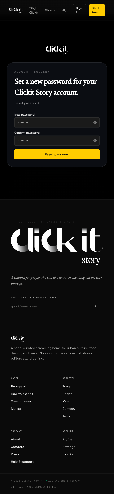

Mostly the same primitives as `/auth`. Inherits font-size and touch-target concerns. Lower priority because of low traffic.

### 12. Shorts overlay (modal)

**Status**: not interactively tested (would require triggering from browse)

Static analysis: [src/components/shorts/shorts-overlay.tsx](../../../src/components/shorts/shorts-overlay.tsx) is a full-screen swipe gallery. Risk: body scroll lock when modal is open; fixed-position close button needs `top-[env(safe-area-inset-top)]` for iOS notch. To verify in a follow-up live test.

### 13. Admin dashboard `/admin`

**Status**: not captured (auth-gated; redirects to /browse)

Static analysis: [src/app/[locale]/admin/page.tsx](../../../src/app/[locale]/admin/page.tsx) renders an admin profile card + [shows-table.tsx](../../../src/components/admin/shows-table.tsx).

| Severity | Issue | Viewport | File / line | Fix sketch |
|---|---|---|---|---|
| P1 | Row action icon buttons (`size="icon-sm"` ≈ 32px) on touch | <500 (static) | [shows-table.tsx:197-220](../../../src/components/admin/shows-table.tsx#L197) | `size="icon"` (40px+) on mobile or use a meatball menu |
| P2 | Genre / Eps / Broadcast columns are `hidden sm:table-cell`, `hidden md:table-cell`, `hidden lg:table-cell` — correctly responsive | — | [shows-table.tsx:163-167](../../../src/components/admin/shows-table.tsx#L163) | Already good |
| P2 | Genre/featured fallback inside row cell on mobile (line 181) — nice pattern, keep | — | shows-table.tsx:181 | Already good |

### 14. Admin new show `/admin/shows/new`

**Status**: not captured

Static analysis: ShowForm has many fields + image uploads. At 500px each input row is full-width — should work. Risk: image upload widgets may have hover-only delete buttons (verify in fix phase).

### 15. Admin show detail `/admin/shows/[id]`

**Status**: not captured

| Severity | Issue | Viewport | File / line | Fix sketch |
|---|---|---|---|---|
| P1 | Cast member delete button 24×24, `opacity-0 group-hover:opacity-100` — invisible + tiny on touch | <500 (static) | [cast-editor.tsx:147](../../../src/components/admin/cast-editor.tsx#L147) | Always visible on `(hover: none)`, bump to `h-9 w-9` |
| P2 | Show info card uses `lg:flex-row` — stacks correctly below `lg` | — | admin show detail | OK |
| P2 | Episode editor likely has hover-only patterns; verify in fix phase | — | episode-list-editor (if exists) | Verify |

### 16. Admin edit show `/admin/shows/[id]/edit`

Same as #14 (uses ShowForm).

### 17. Admin settings `/admin/settings`

**Status**: not captured

Multi-tab layout. Risk: tab triggers may overflow horizontally on mobile if there are many tabs. Verify in fix phase.

### 18. Admin archive `/admin/archive`

**Status**: not captured

Table layout. Same `hidden md:table-cell` pattern as shows-table likely applies. Verify.

### 19. Admin audit log `/admin/audit`

**Status**: not captured

| Severity | Issue | Viewport | File / line | Fix sketch |
|---|---|---|---|---|
| P1 | 4-column table (when, action, entity, details) with `max-w-xl` on details — likely overflows on `<md:` | <500 (static) | [admin/audit/page.tsx](../../../src/app/[locale]/admin/audit/page.tsx) | Wrap in `overflow-x-auto`, or hide entity column on mobile |

### 20. Admin shorts `/admin/shorts`

**Status**: not captured

Table layout. Same general concerns as other admin tables.

---

## Lighthouse mobile audit (landing)

Run on https://clickit-cit.vercel.app/en, mobile emulation, navigation mode:

- Accessibility: **90 / 100**
- Best Practices: **100 / 100**
- SEO: **100 / 100**
- Failures: 3 a11y items
  - `button-name` — buttons missing accessible name
  - `color-contrast` — at least one pair below 4.5:1
  - `heading-order` — non-sequential headings

Fix these in the touch & a11y polish phase (FOLLOWUP Phase C below).

---

## Cleanup before fixes

A few things showed up during analysis that aren't strict mobile bugs but worth filing:

- The orphaned `MobileNav` component suggests it was developed in a previous phase (likely Phase 19 "Header & Footer Shell" per `.planning/STATE.md`) but the wiring was lost in a later refactor or never landed. Worth a `git log -p src/components/layout/mobile-nav.tsx` to confirm the original integration intent before re-wiring.
- The MOBILE_NAV_LINKS constant lives in `nav-links.ts` — exists. Verify nothing else stale.

---

## Verification this audit is complete

- ✅ 12 viewer screens covered (8 with screenshots, 4 with static analysis due to auth gating)
- ✅ 8 admin screens covered via static analysis (auth gating prevented live capture)
- ✅ Cross-cutting findings name 8 themes with file:line refs
- ✅ Lighthouse mobile run on landing
- ✅ DOM-probe data captured for landing, browse, coming-soon, support, auth, search, watch, series detail
- ⚠️ Could not capture: my-list, profile (need user session); /admin/* (need admin session)
- ⚠️ Screenshots are at 500px (MCP minimum) instead of 375 — narrower-viewport findings rely on code analysis

If the user wants the auth-gated screens captured live, that requires either a test account being added to the audit run or signing in through the admin panel manually. For now, the static analysis is sufficient to scope follow-up fixes.
